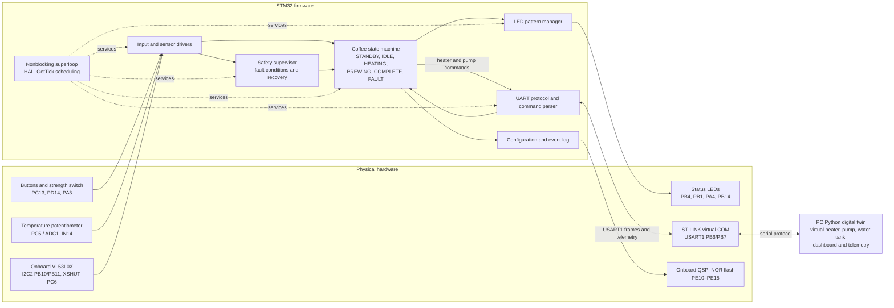
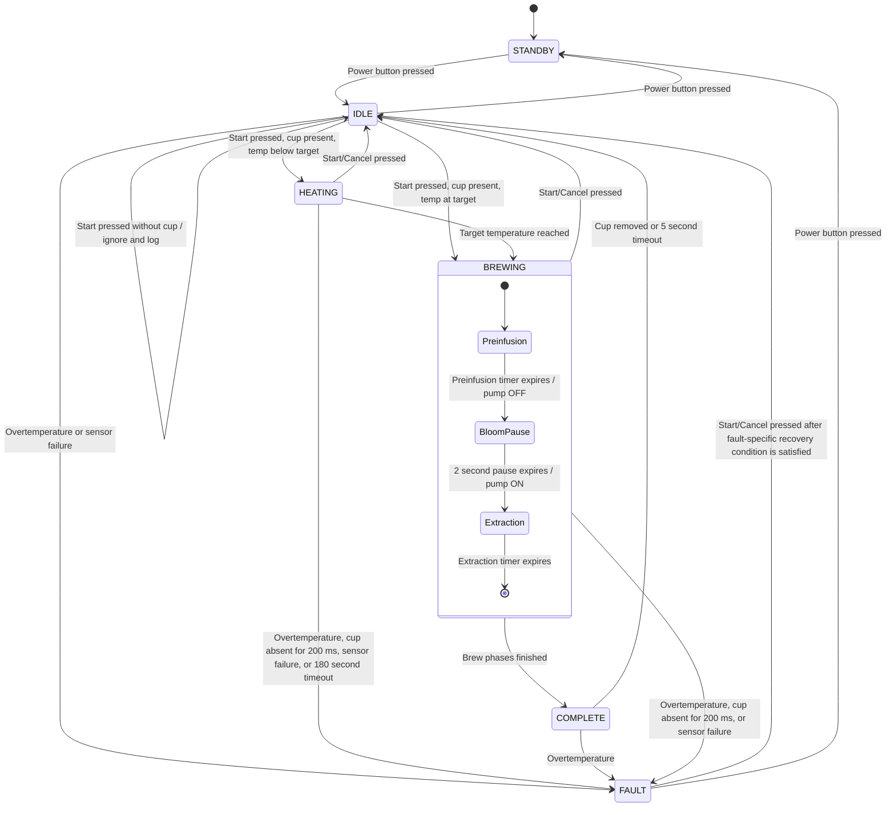

# Coffee Maker Functional Block Diagram

This document includes the overall design and state-machine map. The coffee application, sensor polling, state/output integration, QSPI event logger, and USART1 telemetry are implemented in source. A guided USART1 ToF calibration mode collects clear/place/remove readings, derives cup-present and cup-absent thresholds, and stores alternating CRC-protected profiles in QSPI sectors 1–2. The coffee app loads the newest valid profile at startup, with 80/100 mm defaults if no valid profile exists. Sector 0 remains untouched; sectors 3–15 contain the event log. The GUI can request event records with `CMD,READ_LOGS` and save them as CSV; it does not issue coffee-state or actuator commands. Calibration, coffee-mode hardware behavior, and QSPI read/write behavior still need board validation.

Presentation-ready 16:9 diagrams: [system block diagram SVG](COFFEE_MAKER_BLOCK_DIAGRAM.svg), [state-machine SVG](COFFEE_MAKER_STATE_MACHINE.svg), and [fault-matrix SVG](COFFEE_MAKER_FAULT_MATRIX.svg), all vector images for PowerPoint. A fourteen-slide step walkthrough, including QSPI storage/retrieval status, a GUI tour, and implementation flow, is indexed in [the presentation guide](../PROJECT_PROGRESS_AND_PRESENTATION_GUIDE.md). PNG previews are in `../Project_Progress/Slide_Previews/`. The detailed editable Mermaid source and state machine are below.

The state-machine slide shows the explicit transitions from IDLE, HEATING, BREWING, and COMPLETE to FAULT, and points to the separate matrix for thresholds, timing, and recovery. A start request without a cup is ignored in IDLE; it does not enter FAULT.

## System blocks and signals

## Coffee state machine

## State outputs

| State | Heater command | Pump command | Indicator behavior |
|---|---:|---:|---|
| STANDBY | 0% | Off | Main indicators off; heartbeat blinks at 1 Hz |
| IDLE | 0% | Off | Ready LED on only when cup is present and selected target temperature is reached |
| HEATING | 100% simulated request | Off | Heating LED blinks at 1 Hz |
| BREWING | 0% direct heater request; target temperature remains available to the twin | On during preinfusion/extraction; off during bloom pause | Heating LED solid |
| COMPLETE | 0% | Off | Ready and heating LEDs blink together |
| FAULT | 0% | Off | Fault LED blinks at 4 Hz |

The physical board does not switch a real heater or pump. The actuator commands go to the PC digital twin over USART1.
