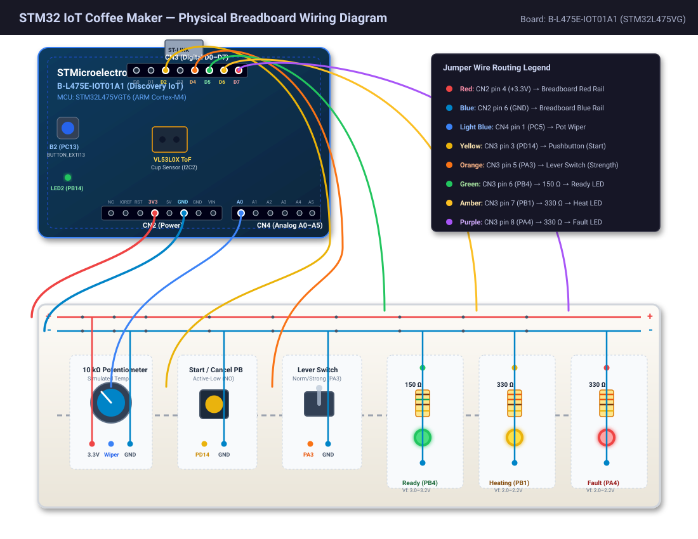

# Physical Wiring Diagram — B-L475E-IOT01A1 & External Breadboard

This document provides the physical point-to-point connection diagram and component layout between the **STM32 B-L475E-IOT01A1 Discovery board** and an external breadboard.

## Visual Vector Diagram (Fritzing Style)



**Illustrative and not to scale.** Route all board connections by the PCB silkscreen labels (`3V3`, `GND`, `A0`, `D2`, `D4`, `D5`, `D6`, `D7`). Do not determine pin 1 by counting positions in this drawing. The visual CN3 right-to-left orientation is shown for reference only.

Use a three-lug, two-position SPDT toggle for the strength selector. Identify COM and the two throws with a continuity meter before connecting it. Wire COM to PA3; the grounded throw selects **Strong**, and the open throw selects **Normal** through PA3's internal pull-up. PD14 also uses its internal pull-up. The lever's physical direction depends on how the switch is mounted.

---

## 1. Physical Layout Diagram

```text
       =========================== B-L475E-IOT01A1 (TOP VIEW) ===========================
      |                                                                                 |
      |   [ST-LINK USB]                                                                 |
      |                                                                                 |
      |   (CN1 - Digital D8-D15)             (CN3 - Digital D0-D7)                      |
      |    Pin 1: D8 (PB2)                    Pin 8: D7 (PA4)                            |
      |    Pin 2: D9 (PA15)                   Pin 7: D6 (PB1)                            |
      |    Pin 3: D10 (PA2)                   Pin 6: D5 (PB4)                            |
      |    Pin 4: D11 (PA7)                   Pin 5: D4 (PA3) -----.                     |
      |    Pin 5: D12 (PA6)                   Pin 4: D3 (PB0)       |                     |
      |    Pin 6: D13 (PA5)                   Pin 3: D2 (PD14) --.   |                     |
      |    Pin 7: GND                         Pin 2: D1 (PA0)    |   |                     |
      |    Pin 8: AREF                        Pin 1: D0 (PA1) <-- rightmost pin             |
      |    Pin 9: SDA (PB9)                                      |   |                     |
      |    Pin 10: SCL (PB8)                                     |   |                     |
      |   [User Button B2]                                       |   |                     |
      |   (PC13 Blue)                                            |   |                     |
      |   [BUTTON_EXTI13]                                        |   |                     |
      |         [Onboard VL53L0X ToF Sensor]                     |   |                     |
      |         (I2C2: PB10/PB11, XSHUT: PC6)                    |   |                     |
      |    Pin 1: NC       |||  |   |                                                   |
      |    Pin 2: IOREF    |||  |   |        (CN4 - Analog A0-A5)                       |
      |    Pin 3: NRST     |||  |   |         Pin 1: A0 (PC5) ----.                     |
      |    Pin 4: 3.3V ----+|+--+---+-----+   Pin 2: A1 (PC4)     |                     |
      |    Pin 5: 5V       |||  |   |     |   Pin 3: A2 (PC3)     |                     |
      |    Pin 6: GND -----+|+--+---+--.  |   Pin 4: A3 (PC2)     |                     |
      |    Pin 7: GND      |||  |   |  |  |   Pin 5: A4 (PC1)     |                     |
      |    Pin 8: VIN      |||  |   |  |  |   Pin 6: A5 (PC0)     |                     |
      |                    |||  |   |  |  |                       |                     |
       ====================|||==|===|==|==|=======================|=====================
                           |||  |   |  |  |                       |
                           |||  |   |  |  |                       |
                           vvv  v   v  v  v                       v
       ============================= EXTERNAL BREADBOARD ===============================
      |                                                                                 |
      |  (+) [RED POWER RAIL (+3.3V)] <=========================== CN2 Pin 4 (3.3V)     |
      |  (-) [BLUE GROUND RAIL (GND)] <=========================== CN2 Pin 6 (GND)      |
      |                                                                                 |
      |  [POTENTIOMETER] (10 kΩ Linear - Simulates Water Temp)                          |
      |    Pin 1 (Left Leg)   --------> Connected to (+) RED RAIL (+3.3V)               |
      |    Pin 2 (Wiper/Mid)  --------> Connected to CN4 Pin 1 (PC5 / A0)                |
      |    Pin 3 (Right Leg)  --------> Connected to (-) BLUE RAIL (GND)                |
      |                                                                                 |
      |  [PUSHBUTTON] (Momentary NO - Start / Cancel)                                   |
      |    Terminal 1         --------> Connected to CN3 Pin 3 (PD14 / D2)              |
      |    Terminal 2         --------> Connected to (-) BLUE RAIL (GND)                |
      |                                                                                 |
      |  [STRENGTH SELECTOR] (3-terminal SPDT Toggle - Normal / Strong)                 |
      |    Common (COM)       --------> Connected to CN3 Pin 5 (PA3 / D4)              |
      |    Selected throw    --------> Connected to (-) BLUE RAIL (GND)                |
      |    Other throw       --------> Leave unconnected                              |
      |                                                                                 |
      |  [GREEN READY LED]                                                              |
      |    Anode (+)          --------> 150 Ω Resistor --------> CN3 Pin 6 (PB4 / D5)   |
      |    Cathode (-)        --------> Connected to (-) BLUE RAIL (GND)                |
      |                                                                                 |
      |  [YELLOW HEATING/BREWING LED]                                                   |
      |    Anode (+)          --------> 330 Ω Resistor --------> CN3 Pin 7 (PB1 / D6)   |
      |    Cathode (-)        --------> Connected to (-) BLUE RAIL (GND)                |
      |                                                                                 |
      |  [RED FAULT LED]                                                                |
      |    Anode (+)          --------> 330 Ω Resistor --------> CN3 Pin 8 (PA4 / D7)   |
      |    Cathode (-)        --------> Connected to (-) BLUE RAIL (GND)                |
      |                                                                                 |
      |  (-) [COMMON GROUND BUS] =====> All GND returns tie to Blue Rail                |
       =================================================================================
```

---

## 2. Jumper Wire Connection Schedule

| Wire # | Origin (STM32 Board) | Destination (Breadboard) | Wire Color (Recommended) | Description |
| :---: | :--- | :--- | :---: | :--- |
| **W1** | **CN2 pin 4** (`3.3V`) | Breadboard **Red Rail (+)** | **Red** | Main +3.3V DC Power Bus |
| **W2** | **CN2 pin 6** (`GND`) | Breadboard **Blue Rail (-)** | **Black** | Common Ground Bus |
| **W3** | Breadboard **Red Rail (+)** | Potentiometer Outer Pin 1 | **Red** | Potentiometer High Reference (3.3V) |
| **W4** | **CN4 pin 1** (`PC5` / A0) | Potentiometer Center Pin 2 | **Blue** | Potentiometer Analog Voltage Wiper |
| **W5** | Breadboard **Blue Rail (-)** | Potentiometer Outer Pin 3 | **Black** | Potentiometer Low Reference (0V) |
| **W19** | PC5 potentiometer wiper row | C1, 100 nF capacitor leg 1 | *Component Lead* | Filter capacitor from the ADC wiper |
| **W20** | C1, 100 nF capacitor leg 2 | Breadboard **Blue Rail (-)** | *Component Lead* | Filter capacitor ground return |
| **W6** | **CN3 pin 3** (`PD14` / D2) | Start/Cancel Button Leg 1 | **Yellow** | Active-Low Pushbutton Signal |
| **W7** | Breadboard **Blue Rail (-)** | Start/Cancel Button Leg 2 | **Black** | Pushbutton Ground Return |
| **W8** | **CN3 pin 5** (`PA3` / D4) | Strength selector **COM** terminal | **Orange** | Active-Low Strength Switch Signal |
| **W9** | Breadboard **Blue Rail (-)** | One selected outer switch throw | **Black** | Grounds PA3 in one position; leave the other throw unconnected |
| **W10**| **CN3 pin 6** (`PB4` / D5) | Ready LED Series Resistor (150 Ω) | **Green** | Ready LED Drive Output |
| **W11**| Resistor (150 Ω) Output | Ready LED Anode (+) | *Component Lead* | Current-limited Green LED Anode |
| **W12**| Ready LED Cathode (-) | Breadboard **Blue Rail (-)** | **Black** | Ready LED Ground Return |
| **W13**| **CN3 pin 7** (`PB1` / D6) | Heating LED Resistor (330 Ω) | **White** | Heating/Brewing LED Drive Output |
| **W14**| Resistor (330 Ω) Output | Heating LED Anode (+) | *Component Lead* | Current-limited Yellow LED Anode |
| **W15**| Heating LED Cathode (-) | Breadboard **Blue Rail (-)** | **Black** | Heating LED Ground Return |
| **W16**| **CN3 pin 8** (`PA4` / D7) | Fault LED Resistor (330 Ω) | **Purple** | Fault LED Drive Output |
| **W17**| Resistor (330 Ω) Output | Fault LED Anode (+) | *Component Lead* | Current-limited Red LED Anode |
| **W18**| Fault LED Cathode (-) | Breadboard **Blue Rail (-)** | **Black** | Fault LED Ground Return |

---

## 3. Physical Breadboard Step-by-Step Assembly Instructions

### Step 1: Power & Common Ground Rails
1. Connect jumper **W1** (Red) from **CN2 pin 4** (`3.3V`) on the STM32 board to the breadboard top **Red (+) Rail**.
2. Connect jumper **W2** (Black) from **CN2 pin 6** (`GND`) on the STM32 board to the breadboard top **Blue (-) Rail**.
3. If using both top and bottom breadboard rails, bridge (+) to (+) and (-) to (-) with short jumpers.

### Step 2: Potentiometer (Simulated Temperature)
1. Insert the 3-pin 10 kΩ potentiometer across three independent terminal rows (e.g., rows 5, 6, 7).
2. Connect row 5 (Pin 1) to the **Red (+) Rail** via wire **W3**.
3. Connect row 7 (Pin 3) to the **Blue (-) Rail** via wire **W5**.
4. Connect row 6 (Pin 2 / Wiper) to **CN4 pin 1** (`PC5`) via wire **W4**.
5. Place C1 (100 nF ceramic) with one leg in the wiper row (wire **W19**) and the other leg in the **Blue (-) Rail** (wire **W20**). This puts C1 between PC5 and GND.
*(The PC13 power button and its pull-up/capacitor network are onboard; do not add a breadboard connection for PC13.)*

### Step 3: Start / Cancel Pushbutton
1. Place a momentary 2-pin or 4-pin tactile pushbutton straddling the center divider (e.g., row 12).
2. Connect one terminal to **CN3 pin 3** (`PD14`) via wire **W6**.
3. Connect the diagonal or paired terminal to the **Blue (-) Rail** via wire **W7**.
*(Note: Internal pull-up resistor on PD14 keeps the line HIGH; pressing the button pulls it to GND).*

### Step 4: Normal / Strong Three-Terminal Switch
1. With the board unplugged, use a multimeter in continuity mode to identify the **common (COM)** terminal. In each toggle position, COM should connect to a different outer terminal.
2. Place the switch so all three lugs occupy separate breadboard rows.
3. Connect **COM** to **CN3 pin 5** (`PA3`) via wire **W8**.
4. Connect one outer throw to the **Blue (-) Rail** via wire **W9**. Leave the other outer throw unconnected and isolated.
5. The position that closes COM to the grounded throw is **Strong** (PA3 low). The other position is **Normal** (PA3 high through the MCU pull-up). If the lever direction is reversed, move the ground wire to the other outer throw.

### Step 5: External Status LEDs
1. **Green Ready LED**:
   * Insert a 150 Ω resistor (Brown-Green-Brown-Gold) between row 22 and row 23.
   * Connect row 22 to **CN3 pin 6** (`PB4`) via wire **W10**.
   * Insert the Green LED Anode (longer lead) into row 23, and Cathode (shorter lead) into the **Blue (-) Rail**.
   * The 150 Ω value assumes a high-forward-voltage green LED. Check the LED datasheet and choose the resistor from `R = (3.3 V − Vf) / I_LED`; keep current within both the LED and STM32 GPIO ratings.
2. **Yellow Heating/Brewing LED**:
   * Insert a 330 Ω resistor (Orange-Orange-Brown-Gold) between row 26 and row 27.
   * Connect row 26 to **CN3 pin 7** (`PB1`) via wire **W13**.
   * Insert the Yellow LED Anode into row 27, and Cathode into the **Blue (-) Rail**.
3. **Red Fault LED**:
   * Insert a 330 Ω resistor (Orange-Orange-Brown-Gold) between row 30 and row 31.
   * Connect row 30 to **CN3 pin 8** (`PA4`) via wire **W16**.
   * Insert the Red LED Anode into row 31, and Cathode into the **Blue (-) Rail**.

---

## 4. Hardware Safety & Polarity Check Prior to Power-Up

* [ ] **Ground Continuity**: Verify with a multimeter that all switch commons, potentiometer ground leg, and LED cathodes share $0.0\ \Omega$ resistance to STM32 `GND` (CN2 pin 6).
* [ ] **No Short Between 3.3V and GND**: Measure resistance between Red (+) rail and Blue (-) rail with power disconnected; must read $> 1\text{ k}\Omega$.
* [ ] **LED Polarity**: Confirm that flat package rims/shorter leads are in the ground rail, and series resistors are connected between the GPIO lines and the anodes.
* [ ] **Wiper Voltage**: Wiper pin (PC5) must never exceed +3.3 V.
