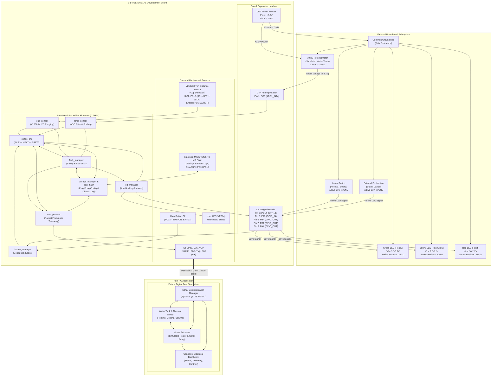

# System Block Diagram — STM32 IoT Coffee Maker

This document defines the high-level system architecture, hardware-software boundaries, and subsystem interconnects between the **STM32L475VG Microcontroller**, physical external breadboard interfaces, onboard sensors, and the **PC Python Digital Twin**.

---

## 1. Complete Architecture Diagram

---

## 2. Subsystem Interface Breakdown

### 2.1 Sensor & Input Subsystem
* **Potentiometer (PC5 / ADC1_IN14)**:
  * Analog input range: $0.0\text{ V} \le V_{in} \le 3.3\text{ V}$.
  * Sampled periodically by `temp_sensor` using non-blocking ADC conversions.
  * Scaled to representation of boiler water temperature ($20^\circ\text{C}$ to $110^\circ\text{C}$).
* **User Buttons & Switches**:
  * **PC13 (Onboard User Button B2, BUTTON_EXTI13)**: System Power Toggle (Standby vs Active). Note: B1 is NRST Reset button.
  * **PD14 (External Pushbutton)**: Brew Start / Abort command.
  * **PA3 (External Lever Switch)**: Coffee profile selector:
    * Logic High (`1`): Normal Brew (Standard water volume & duration).
    * Logic Low (`0`): Strong Brew (Extended pre-infusion & extraction profile).
* **Cup Presence Sensor (VL53L0X)**:
  * Communicates via I2C2 (`PB10` SCL / `PB11` SDA) at $100\text{ kHz}$.
  * Measures distance to platform in millimeters.
  * Hysteresis qualification: Cup Present ($d < 80\text{ mm}$), Cup Absent ($d \ge 100\text{ mm}$).

---

### 2.2 Actuator & Output Subsystem
* **Physical Status Indicators (External LEDs)**:
  * **Ready LED (PB4 / 150 Ω)**: Solid Green indicates system is powered, water is heated to target temperature, and cup is detected.
  * **Heating / Brewing LED (PB1 / 330 Ω)**:
    * Pulsing/Blinking (1 Hz): Water is heating to target temperature.
    * Solid Yellow: Pump active, actively dispensing coffee into cup.
  * **Fault LED (PA4 / 330 Ω)**: Fast Blinking (4 Hz) or Solid Red indicating an interlock violation (e.g., cup removed mid-brew, thermal fault, water reservoir empty).
* **Onboard Heartbeat LED (PB14)**:
  * Toggles every 500 ms to confirm non-blocking superloop health.

---

### 2.3 PC Python Digital Twin Subsystem
* **Physical Link**: Full-speed USB virtual serial link through ST-LINK VCP on `PB6` (TX) and `PB7` (RX) at **115,200 baud, 8 data bits, no parity, 1 stop bit (8N1)**.
* **Role Separation**:
  * **STM32 Controller**: Owns all safety logic, state transitions, hardware reading, debouncing, and local LED indication.
  * **Python Digital Twin**:
    * Simulates high-voltage actuators (Heater heating element and 15-bar water pump).
    * Simulates physical plant thermodynamics (thermal loss, boiler heating rate based on wattage).
    * Simulates water reservoir level and consumption per brew.
    * Provides user monitoring interface and fault injection for automated validation.
