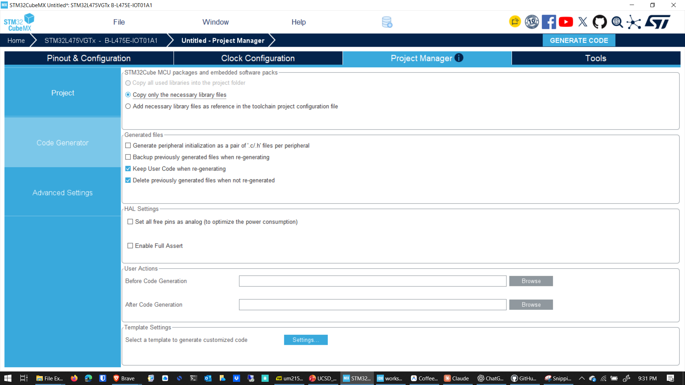
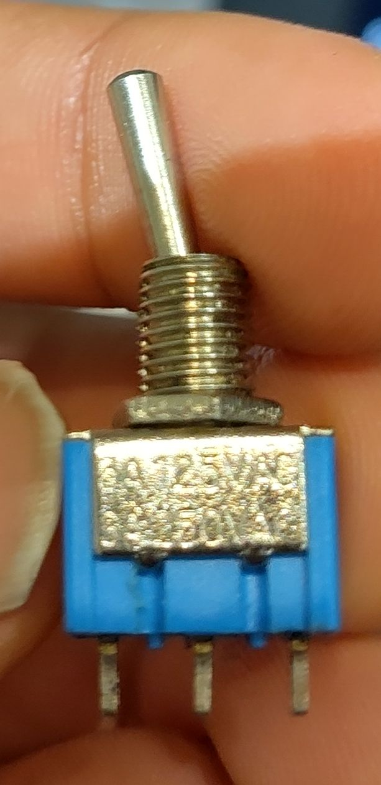
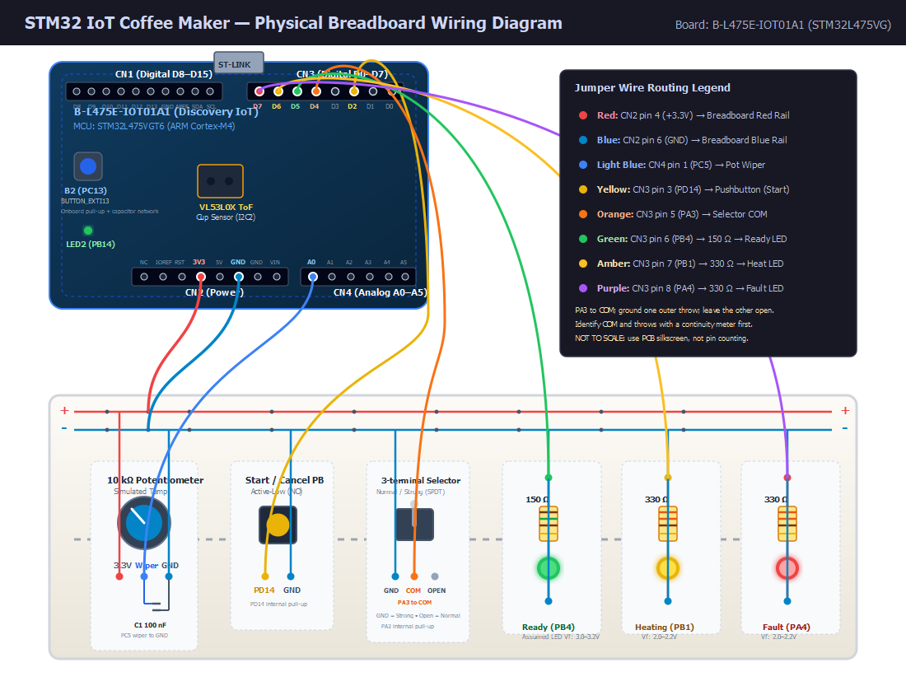
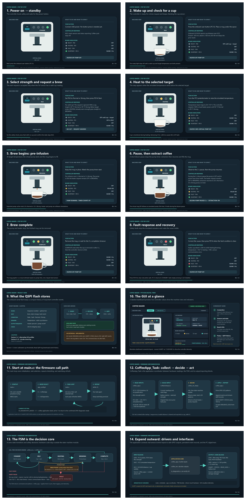

# IoT Coffee Maker Project Progress and Presentation Guide

**Project:** STM32 IoT Coffee Maker  
**Board:** B-L475E-IOT01A1, STM32L475VGTX  
**IDE:** STM32CubeIDE / STM32CubeMX  
**Last updated:** 2026-11-21

This guide records the setup work completed so far and provides a slide outline for a screenshot-based project presentation. The example presentation supplied by the project owner is `UCSD_ex_Embedded_C_Assignment_8_I2C_Adithya_Naresh.pptx`.

## Project overview

The STM32 board will read physical controls and sensors, run the coffee-maker state machine, drive indicator LEDs, and communicate with a Python digital twin over the ST-LINK virtual COM port. The heater and pump are simulated in software; no mains-powered actuator is connected.

## Work completed

### 1. STM32CubeMX project created

- Selected the B-L475E-IOT01A1 board / STM32L475VGTX MCU.
- Created the STM32CubeIDE project `FinalProject_STM32` under the main project folder.
- Selected STM32Cube FW_L4 V1.18.2 in the initial setup.
- Kept generated `main()` enabled and selected “Keep User Code when re-generating.”
- Project files are in `../FinalProject_STM32/`.

### 2. USART1 host link configured

- USART1 asynchronous mode.
- 115200 baud, 8 data bits, no parity, 1 stop bit (8N1).
- Hardware flow control disabled; transmit and receive enabled.
- PB6 is USART1_TX and PB7 is USART1_RX for the ST-LINK virtual COM port.

### 3. ADC potentiometer input configured

- PC5 is ADC1_IN14 and is labeled `A0_TEMP_POT`.
- ADC resolution is 12-bit; channel 14 is Rank 1.
- Sampling time was changed from 2.5 to 92.5 cycles to allow the potentiometer input more acquisition time.
- ADC clock in the project configuration is 48 MHz.
- The planned breadboard circuit uses a 10 kΩ potentiometer between 3.3 V and ground, with the wiper connected to PC5. A 100 nF capacitor from PC5/wiper to ground is recommended for filtering.

### 4. I2C2 ToF connection configured

- I2C2 is set to Standard mode (100 kHz).
- PB10 is I2C2_SCL and PB11 is I2C2_SDA.
- The VL53L0X time-of-flight cup sensor is onboard. It needs no external breadboard wiring.
- PC6 is the sensor XSHUT control; PC7 is available for the optional data-ready interrupt.

### 5. External wiring drawing reviewed

The connection list in `Diagrams/PHYSICAL_WIRING.md` and `Diagrams/PHYSICAL_WIRING.svg` matches the selected board/header pins:

| Circuit | Board connection | Breadboard connection |
|---|---|---|
| Power rail | CN2 pin 4, 3.3 V | Red rail |
| Ground rail | CN2 pin 6, GND | Blue rail |
| Temperature control | CN4 pin 1, PC5/A0 | Potentiometer wiper |
| Start/cancel | CN3 pin 3, PD14/D2 | Momentary switch to GND |
| Strength select | CN3 pin 5, PA3/D4 | Three-terminal SPDT switch: COM to PA3, one outer throw to GND, other throw open |
| Ready indicator | CN3 pin 6, PB4/D5 | Green LED through 150 Ω to GPIO; LED cathode to GND |
| Heating/brewing indicator | CN3 pin 7, PB1/D6 | Yellow LED through 330 Ω to GPIO; LED cathode to GND |
| Fault indicator | CN3 pin 8, PA4/D7 | Red LED through 330 Ω to GPIO; LED cathode to GND |

The drawing is updated for the three-terminal, two-position SPDT strength selector. PA3 goes to COM, one outer throw goes to GND, and the other outer throw stays unconnected. Use a continuity meter to identify the contacts; if the mode direction is reversed, move GND to the other outer throw. The drawing now shows the PC5-to-GND 100 nF filter capacitor and labels the onboard PC13 button network. It is illustrative and not to scale; wire by the PCB silkscreen labels, not by counting positions in the drawing. The ToF sensor is onboard and needs no breadboard connection.

### 6. Watchdog and first application logic

- IWDG remains enabled with prescaler 32 and reload 1000.
- `Src/main.c` now calls `HAL_IWDG_Refresh(&hiwdg)` inside the main superloop. This refresh should remain after all scheduled work once the application scheduler is connected.
- A HAL-free state machine module has been started in `Inc/coffee_sm.h` and `Src/coffee_sm.c`. It defines the coffee states, faults, input/output structures, brew phases, cancellation, and LED/heater/pump requests.
- The HAL-free state machine is integrated through `coffee_app.c` and selected from the `main.c` user-code hooks. USART1 transmits status and accepts the read-only `CMD,READ_LOGS` QSPI retrieval request; it does not accept state or actuator commands.
- `main.c` initializes peripherals and refreshes IWDG; compile-time selection chooses guided ToF calibration, GPIO diagnostics, or the integrated coffee application task.
- Added a compile-time selectable I/O diagnostic task in `FinalProject_STM32/Src/io_diagnostics.c`. The user confirmed diagnostic mode works on hardware: LED cycle, digital input readings, PC5 ADC, ToF I2C acknowledgment, and USART1 reporting. It is selected with `IO_DIAGNOSTICS_MODE=1`; the current setting is `0` for the integrated coffee application.
- Added the coffee application integration in `FinalProject_STM32/Src/coffee_app.c`: 30 ms input qualification, filtered ADC-to-simulated-temperature mapping, VL53L0X single-ranging measurements at 100 ms intervals (not gesture mode), saved cup thresholds (80/100 mm defaults), zero-mm rejection, state-machine input/output mapping, QSPI event logging, and USART1 status telemetry at 10 Hz with explicit LED output levels. The app resets XSHUT and retries after repeated I2C/API failures. A successful transaction with an invalid range result is treated as no usable target, not an I2C communication fault; invalid cup readings count toward the no-cup safety timeout during an active cycle. Current source has `IO_TOF_CALIBRATION_MODE=0` and `IO_DIAGNOSTICS_MODE=0`, selecting coffee app and QSPI command handling. Coffee-mode hardware ranging/state behavior remains unverified.
- Added a guided ToF calibration task in `tof_calibration.c`. USART1 reports ten raw samples each for clear, cup placed, and cup removed stages; press Enter at the two prompts. Passing threshold checks save measured medians and derived cup-present/cup-absent thresholds, with CRC and read-back verification, to alternating QSPI profile slots in sectors 1–2. The coffee app loads the newest valid profile at startup; sector 0 remains untouched, and sectors 3–15 remain the event log. Calibration and QSPI persistence still need physical board validation.
- Added `DigitalTwin/coffee_twin.py`, a read-only control dashboard with an animated machine, LED lamps driven by explicit firmware telemetry, cup/temperature/state/fault indicators, simulated heater/pump status, pump-on-time timer, virtual mug fill animation, and a 500 ms stale-link indication. It hides cup distance unless telemetry marks it valid, avoiding stale readings across sensor resets/retries. Its **Read QSPI log** action sends `CMD,READ_LOGS`, displays returned records in a table, and saves CSV. A local Miniconda environment is available at `DigitalTwin/.conda-env/` (Python 3.12, pyserial 3.5; ignored by git); recreate it with `DigitalTwin/environment.yml`. It ignores diagnostic-mode `DIAG` lines; set diagnostics to 0 to receive application `STATUS` messages. The GUI does not issue coffee-state or actuator commands.
- Added `qspi_flash.c/.h` and `storage_manager.c/.h`. The firmware reads JEDEC `0xC22817` and logs CRC-protected 32-byte boot/state/fault records in the 52 KB event area (sectors 3–15). Two alternating CRC-protected ToF profile slots occupy sectors 1–2; sector 0 remains untouched. Diagnostics report the ID; coffee mode initializes flash and appends events. `CMD,READ_LOGS` streams valid event records over USART1 to the GUI, which can save CSV. QSPI is configured at 20 MHz for single-line command mode. Hardware calibration save/load and event-log retrieval still need validation.
- `Diagrams/COFFEE_MAKER_FUNCTIONAL_BLOCK_DIAGRAM.md` contains the system flowchart and state diagram; presentation SVGs and the fault matrix are linked there.

## Current project state and next work

- Generated startup and peripheral initialization files are present.
- The HAL-free coffee state machine is connected to the application task and main loop. GPIO diagnostics are selected with `IO_DIAGNOSTICS_MODE=1`; guided ToF calibration is selected with `IO_TOF_CALIBRATION_MODE=1`. Both must be 0 for the coffee app and QSPI log command.
- IWDG is enabled in CubeMX with prescaler 32 and reload 1000. `main.c` refreshes it at the end of the current superloop. Keep that refresh after all scheduled application work when the loop is expanded.
- Before wiring: keep the board disconnected from USB while placing and checking connections. Confirm the 3.3 V and ground rails are not shorted, check LED polarity and series resistors, then connect the board. Breadboard wiring can start now; it does not need to wait for coffee logic or a firmware flash.
- Next milestone: rebuild/flash the current coffee-app mode and verify the GUI QSPI log response. If calibration is still needed, set `IO_TOF_CALIBRATION_MODE=1`, keep diagnostics at 0, run the clear/place/remove UART prompts, then return it to 0. Verify a passing profile survives a reset and the coffee app reports its loaded thresholds. Heater/pump requests remain simulation-only; tank-empty is hardcoded false because no tank sensor is installed.
- The first application task is implemented and the dashboard is ready for serial integration. The potentiometer provides simulated temperature; the Python twin displays virtual heater and pump outputs.
- Hardware verification: diagnostic-mode bring-up passed per user report. Still verify ToF distance/range and then test integrated coffee-state behavior and PC digital-twin protocol.

## Screenshots captured so far

These screenshots are kept locally with the project so they can be reused in the presentation:

1. USART1 serial settings

   

2. CubeMX project settings

   

3. CubeMX code generator settings

   

4. ADC1 channel 14 sampling time

   

5. Three-terminal strength selector supplied for the breadboard

   

6. Updated physical wiring diagram with the SPDT selector

   

## Suggested presentation outline

Use the supplied Assignment 8 presentation as the visual reference. Keep each slide focused on one step and use the screenshots below as evidence; capture additional screenshots as the remaining configuration and tests are completed.

1. **Title and objective** — Coffee-maker controller, board, and project goal.
2. **System architecture** — Use `Diagrams/COFFEE_MAKER_BLOCK_DIAGRAM.svg` (16:9 vector) or its PNG preview. It includes QSPI storage, a bidirectional USART1 link, and an implementation-in-progress label.
3. **CubeMX project setup** — Project settings screenshot.
4. **USART1 PC communication** — USART settings screenshot and 115200 8N1 summary.
5. **GPIO pin assignment** — Capture the final CubeMX pinout with the external control and LED pins labeled.
6. **Temperature input** — ADC channel 14 screenshot, potentiometer wiring, and temperature simulation range.
7. **Cup detection** — I2C2 Standard mode pinout/settings and onboard VL53L0X placement.
8. **Breadboard wiring** — Use `Diagrams/PHYSICAL_WIRING.svg` and a photo of the assembled breadboard after wiring.
9. **Firmware design and safety** — Use `Diagrams/COFFEE_MAKER_STATE_MACHINE.svg` for the state map and `Diagrams/COFFEE_MAKER_FAULT_MATRIX.svg` for fault thresholds and recovery.
10. **Validation results** — Add measured/observed results only after building and testing on the board.

## Screenshot checklist for later

- Final CubeMX pinout view with no unresolved pin conflicts.
- I2C2 timing/settings page showing Standard mode.
- GPIO settings for input pull-ups, EXTI selection, and output initial levels.
- Diagnostic-mode output/input/ADC results, including expected idle/pressed levels and potentiometer sweep range.
- Capture a serial-terminal screenshot and a breadboard/board photo for the successful diagnostic-mode validation slide.

### Diagnostic mode bring-up

Set `IO_DIAGNOSTICS_MODE` to `1` in `FinalProject_STM32/Inc/app_config.h` to select the diagnostic mode. After building and flashing, open the ST-LINK virtual COM port at **115200 8N1**. Every 500 ms the terminal reports raw GPIO levels, PC5 ADC counts (0–4095), ToF address acknowledgment, and the current LED. The four LEDs (Ready, Heating, Fault, onboard heartbeat) advance one at a time in 500 ms steps, with an all-off step. Expected switch/button readings are HIGH when released/open and LOW when pressed/grounded. Turn the potentiometer and confirm the ADC count changes. `TOF=ACK` means the sensor acknowledged address 0x29; this diagnostic does not yet read distance. This mode does not run coffee logic or command the simulated heater/pump.

### Guided ToF cup-detection calibration

To run calibration, set `IO_TOF_CALIBRATION_MODE=1` in `FinalProject_STM32/Inc/app_config.h` and keep `IO_DIAGNOSTICS_MODE=0`. Current source has both set to 0 for coffee-app/QSPI operation. Build and flash, then open the ST-LINK virtual COM port at **115200 8N1** before resetting the board. Keep the sensor unobstructed when it starts. The terminal captures ten clear-view samples, prompts you to place the cup at its normal detection location and press Enter, captures ten samples, then prompts you to remove the cup and press Enter for the final ten. CR, LF, and CRLF Enter settings are supported. Each `TOF_SAMPLE` line includes API result, VL53L0X range status, and millimeters. The final result reports PASS/FAIL and the thresholds.

On PASS, the firmware saves the derived thresholds and sample medians with CRC/read-back verification in alternating QSPI sectors 1–2. Coffee mode loads the newest valid profile after reset and includes the active enter/exit thresholds in `STATUS`; without a valid saved profile it uses 80/100 mm defaults. A failed separation or failed QSPI write does not replace the existing profile. After calibration, set `IO_TOF_CALIBRATION_MODE=0` and `IO_DIAGNOSTICS_MODE=0` to return to the coffee app. Do not erase sectors 1–2 when clearing event logs in sectors 3–15.
- Generated project structure in STM32CubeIDE.
- Build result and serial terminal output.
- Breadboard photo with board unpowered during initial wiring, then a separate powered test photo/video if useful.
- ToF range output with and without a cup.
- State transitions and fault behavior from the integrated system.

## Handoff notes

The current source of truth is the `.ioc` plus the workspace documents. CubeMX is configured for ADC1 channel 14 at 92.5 cycles, I2C2 Standard mode, and USART1 at 115200 8N1. Do not disable IWDG; refresh it at the end of the live superloop and during long QSPI scans. Keep application work out of generated initialization sections, except for retained `USER CODE` areas. The user reports GPIO diagnostic mode works on hardware. Current mode flags are both 0 for the coffee app; set calibration to 1 only for the UART calibration procedure. The Python dashboard is in `DigitalTwin/coffee_twin.py`, receives 10 Hz USART1 `STATUS` lines, and can request/download event records with `CMD,READ_LOGS`. Validate calibration-profile persistence, the desktop UI, QSPI log retrieval, and coffee-mode ranging/state behavior on hardware. Heater/pump outputs are simulation-only.

## PowerPoint step-by-step sequence

Fourteen matching 16:9 SVG slides show user actions and expected outputs, explain QSPI event storage and the Python GUI, then trace the implementation from `main.c` through the application, FSM, drivers, and interfaces. Insert the SVG files directly into PowerPoint for crisp scaling; PNG previews are in `Project_Progress/Slide_Previews/`.

1. `Diagrams/COFFEE_MAKER_STEP_01_POWER_STANDBY.svg` — power-on standby and heartbeat.
2. `Diagrams/COFFEE_MAKER_STEP_02_IDLE_CUP.svg` — wake, cup placement, and ToF thresholds.
3. `Diagrams/COFFEE_MAKER_STEP_03_START_CHECK.svg` — strength selection and no-cup start rejection.
4. `Diagrams/COFFEE_MAKER_STEP_04_HEATING.svg` — simulated temperature and heating indicators.
5. `Diagrams/COFFEE_MAKER_STEP_05_PREINFUSION.svg` — pump timer begins and mug starts filling.
6. `Diagrams/COFFEE_MAKER_STEP_06_BLOOM_EXTRACTION.svg` — 2 s pump pause and extraction.
7. `Diagrams/COFFEE_MAKER_STEP_07_COMPLETE.svg` — full virtual mug and completion indicators.
8. `Diagrams/COFFEE_MAKER_STEP_08_FAULT_RECOVERY.svg` — fault triggers, outputs, and recovery.
9. `Diagrams/COFFEE_MAKER_STEP_09_QSPI_STORAGE.svg` — event record contents, flash area, implemented USART1 retrieval, and CSV export.
10. `Diagrams/COFFEE_MAKER_STEP_10_GUI_TOUR.svg` — screenshot-style GUI tour with callouts for telemetry, LEDs, pump timer, and mug animation.
11. `Diagrams/COFFEE_MAKER_CODE_01.svg` — `main.c` startup, mode selection, repeated task call, and IWDG refresh.
12. `Diagrams/COFFEE_MAKER_CODE_02.svg` — `CoffeeApp_Task` input collection, FSM call, GPIO outputs, QSPI event logging, and USART1 status.
13. `Diagrams/COFFEE_MAKER_CODE_03.svg` — FSM states, direct-to-brew branch, timing phases, and safety conditions.
14. `Diagrams/COFFEE_MAKER_CODE_04.svg` — hardware driver inputs, application core, indicator outputs, flash, and GUI telemetry.

These slides show expected firmware behavior with `IO_DIAGNOSTICS_MODE=0`; coffee-mode hardware behavior still needs validation. The heater, pump, and mug fill remain simulated/illustrative. Slide 9 distinguishes the implemented read command from pending hardware validation; `flash=OK/NO` reports whether QSPI initialized, while `logger=OK/NO` reports event-append health. Log enumeration, logger recovery, and record streaming scan eight slots per task pass so the app can continue its control work.

### Presentation contact sheet

