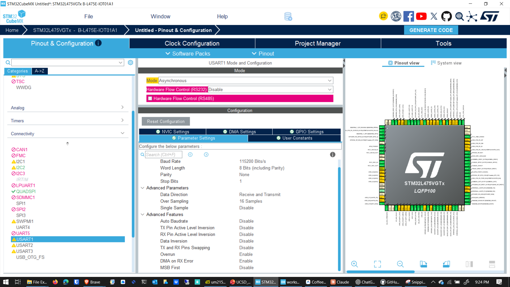
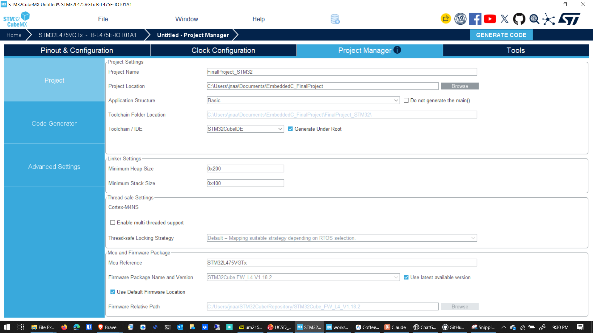
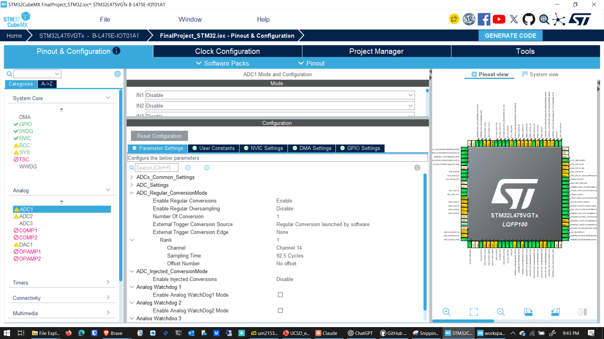

# IoT Coffee Maker Project Progress and Presentation Guide

**Project:** STM32 IoT Coffee Maker  
**Board:** B-L475E-IOT01A1, STM32L475VGTX  
**IDE:** STM32CubeIDE / STM32CubeMX  
**Last updated:** 2026-11-20

This guide records the setup work completed so far and provides a slide outline for a screenshot-based project presentation. The example presentation supplied by the project owner is `UCSD_ex_Embedded_C_Assignment_8_I2C_Adithya_Naresh.pptx`.

## Project overview

The STM32 board will read physical controls and sensors, run the coffee-maker state machine, drive indicator LEDs, and communicate with a Python digital twin over the ST-LINK virtual COM port. The heater and pump are simulated in software; no mains-powered actuator is connected.

## Work completed

### 1. STM32CubeMX project created

- Selected the B-L475E-IOT01A1 board / STM32L475VGTX MCU.
- Created the STM32CubeIDE project `FinalProject_STM32` under the main project folder.
- Selected STM32Cube FW_L4 V1.18.2 in the initial setup.
- Kept generated `main()` enabled and selected “Keep User Code when re-generating.”
- Project files are in `../FinalProject_STM32/`.

### 2. USART1 host link configured

- USART1 asynchronous mode.
- 115200 baud, 8 data bits, no parity, 1 stop bit (8N1).
- Hardware flow control disabled; transmit and receive enabled.
- PB6 is USART1_TX and PB7 is USART1_RX for the ST-LINK virtual COM port.

### 3. ADC potentiometer input configured

- PC5 is ADC1_IN14 and is labeled `A0_TEMP_POT`.
- ADC resolution is 12-bit; channel 14 is Rank 1.
- Sampling time was changed from 2.5 to 92.5 cycles to allow the potentiometer input more acquisition time.
- ADC clock in the project configuration is 48 MHz.
- The planned breadboard circuit uses a 10 kΩ potentiometer between 3.3 V and ground, with the wiper connected to PC5. A 100 nF capacitor from PC5/wiper to ground is recommended for filtering.

### 4. I2C2 ToF connection configured

- I2C2 is set to Standard mode (100 kHz).
- PB10 is I2C2_SCL and PB11 is I2C2_SDA.
- The VL53L0X time-of-flight cup sensor is onboard. It needs no external breadboard wiring.
- PC6 is the sensor XSHUT control; PC7 is available for the optional data-ready interrupt.

### 5. External wiring drawing reviewed

The connection list in `Diagrams/PHYSICAL_WIRING.md` and `Diagrams/PHYSICAL_WIRING.svg` matches the selected board/header pins:

| Circuit | Board connection | Breadboard connection |
|---|---|---|
| Power rail | CN2 pin 4, 3.3 V | Red rail |
| Ground rail | CN2 pin 6, GND | Blue rail |
| Temperature control | CN4 pin 1, PC5/A0 | Potentiometer wiper |
| Start/cancel | CN3 pin 3, PD14/D2 | Momentary switch to GND |
| Strength select | CN3 pin 5, PA3/D4 | SPST switch to GND |
| Ready indicator | CN3 pin 6, PB4/D5 | Green LED through 150 Ω to GPIO; LED cathode to GND |
| Heating/brewing indicator | CN3 pin 7, PB1/D6 | Yellow LED through 330 Ω to GPIO; LED cathode to GND |
| Fault indicator | CN3 pin 8, PA4/D7 | Red LED through 330 Ω to GPIO; LED cathode to GND |

The drawing is correct for these listed circuits. Wire by the board’s printed connector labels (`3V3`, `GND`, `A0`, `D2`, `D4`, `D5`, `D6`, `D7`), rather than relying on a visual pin count. The ToF sensor and PC13 onboard button are already on the board. The optional PC5 capacitor is described in the notes but is not shown as a component in the breadboard drawing.

### 6. Watchdog and first application logic

- IWDG remains enabled with prescaler 32 and reload 1000.
- `Src/main.c` now calls `HAL_IWDG_Refresh(&hiwdg)` inside the main superloop. This refresh should remain after all scheduled work once the application scheduler is connected.
- A HAL-free state machine module has been started in `Inc/coffee_sm.h` and `Src/coffee_sm.c`. It defines the coffee states, faults, input/output structures, brew phases, cancellation, and LED/heater/pump requests.
- The state machine is not yet called from `main.c`; it still needs input/button/sensor drivers and output integration. In particular, the VL53L0X measurement driver and UART protocol implementation remain to be added.
- `Diagrams/COFFEE_MAKER_FUNCTIONAL_BLOCK_DIAGRAM.md` contains the system flowchart and state diagram.

## Current project state and next work

- Generated startup and peripheral initialization files are present.
- A HAL-free coffee state-machine module has been added; it is not yet connected to the hardware drivers or main loop.
- IWDG is enabled in CubeMX with prescaler 32 and reload 1000. `main.c` refreshes it at the end of the current superloop. Keep that refresh after all scheduled application work when the loop is expanded.
- Before wiring: keep the board disconnected from USB while placing and checking connections. Confirm the 3.3 V and ground rails are not shorted, check LED polarity and series resistors, then connect the board. Breadboard wiring can start now; it does not need to wait for coffee logic or a firmware flash.
- Next firmware work: connect the new state-machine module to button, temperature, and cup-sensor drivers; then add LED and UART actuator/telemetry handling. The first milestone assumes the potentiometer is the temperature source; the Python twin simulates the heater and pump.
- Hardware verification still requires a later powered test: ADC readings, button levels, LEDs, UART loopback/telemetry, and ToF sensor communication.

## Screenshots captured so far

These screenshots are kept locally with the project so they can be reused in the presentation:

1. USART1 serial settings

   

2. CubeMX project settings

   

3. CubeMX code generator settings

   

4. ADC1 channel 14 sampling time

   

## Suggested presentation outline

Use the supplied Assignment 8 presentation as the visual reference. Keep each slide focused on one step and use the screenshots below as evidence; capture additional screenshots as the remaining configuration and tests are completed.

1. **Title and objective** — Coffee-maker controller, board, and project goal.
2. **System architecture** — STM32 controller, breadboard controls/LEDs, onboard ToF sensor, PC digital twin.
3. **CubeMX project setup** — Project settings screenshot.
4. **USART1 PC communication** — USART settings screenshot and 115200 8N1 summary.
5. **GPIO pin assignment** — Capture the final CubeMX pinout with the external control and LED pins labeled.
6. **Temperature input** — ADC channel 14 screenshot, potentiometer wiring, and temperature simulation range.
7. **Cup detection** — I2C2 Standard mode pinout/settings and onboard VL53L0X placement.
8. **Breadboard wiring** — Use `Diagrams/PHYSICAL_WIRING.svg` and a photo of the assembled breadboard after wiring.
9. **Firmware design** — State machine, fault handling, and UART protocol after those modules are implemented.
10. **Validation results** — Add measured/observed results only after building and testing on the board.

## Screenshot checklist for later

- Final CubeMX pinout view with no unresolved pin conflicts.
- I2C2 timing/settings page showing Standard mode.
- GPIO settings for input pull-ups, EXTI selection, and output initial levels.
- Generated project structure in STM32CubeIDE.
- Build result and serial terminal output.
- Breadboard photo with board unpowered during initial wiring, then a separate powered test photo/video if useful.
- ToF range output with and without a cup.
- State transitions and fault behavior from the integrated system.

## Handoff notes

The current source of truth is the `.ioc` plus the workspace documents. CubeMX is configured for ADC1 channel 14 at 92.5 cycles, I2C2 Standard mode, and USART1 at 115200 8N1. Do not disable IWDG; refresh it at the end of the live superloop. Keep application work out of generated initialization sections, except for retained `USER CODE` areas. The current milestone is pure coffee state-machine logic; next connect it to the physical input/sensor drivers and simulated actuator/UART layer. No hardware test has been run yet.
